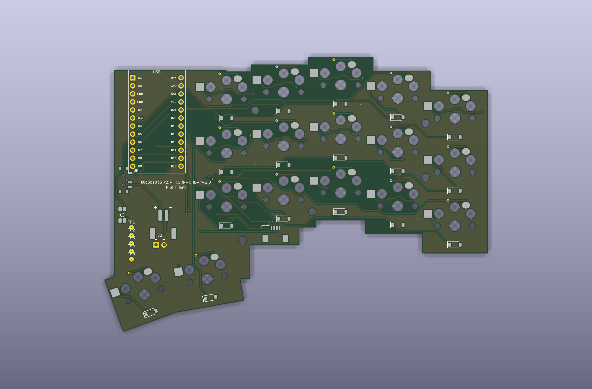
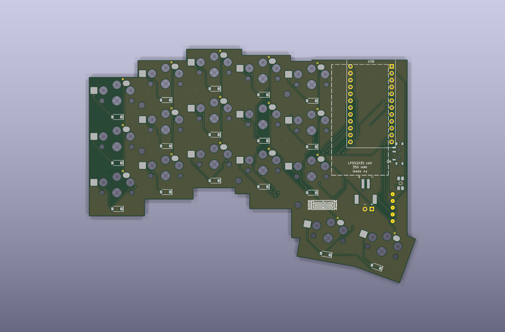
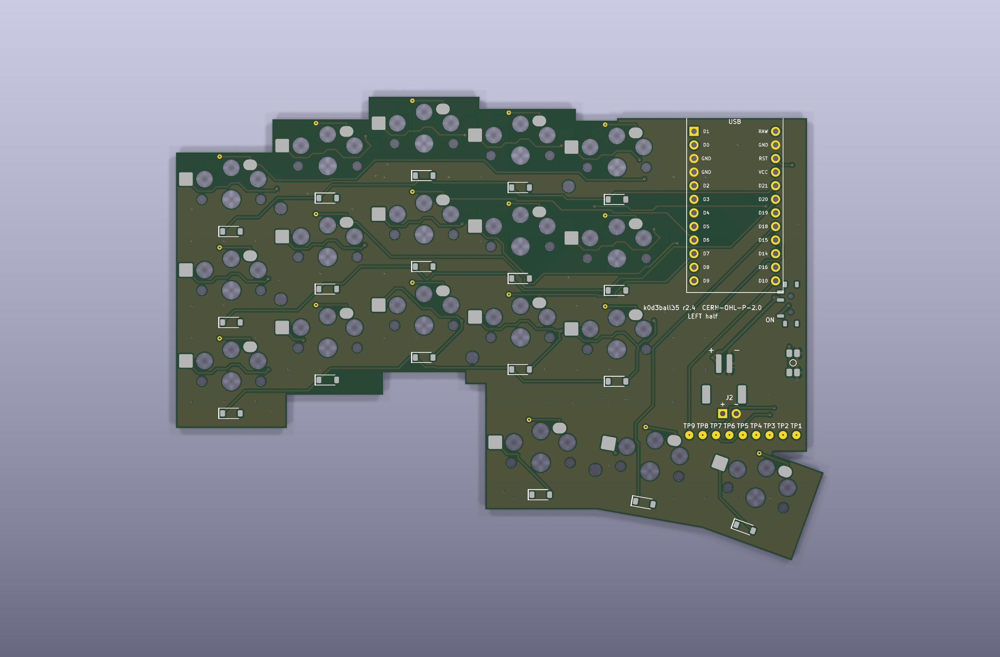
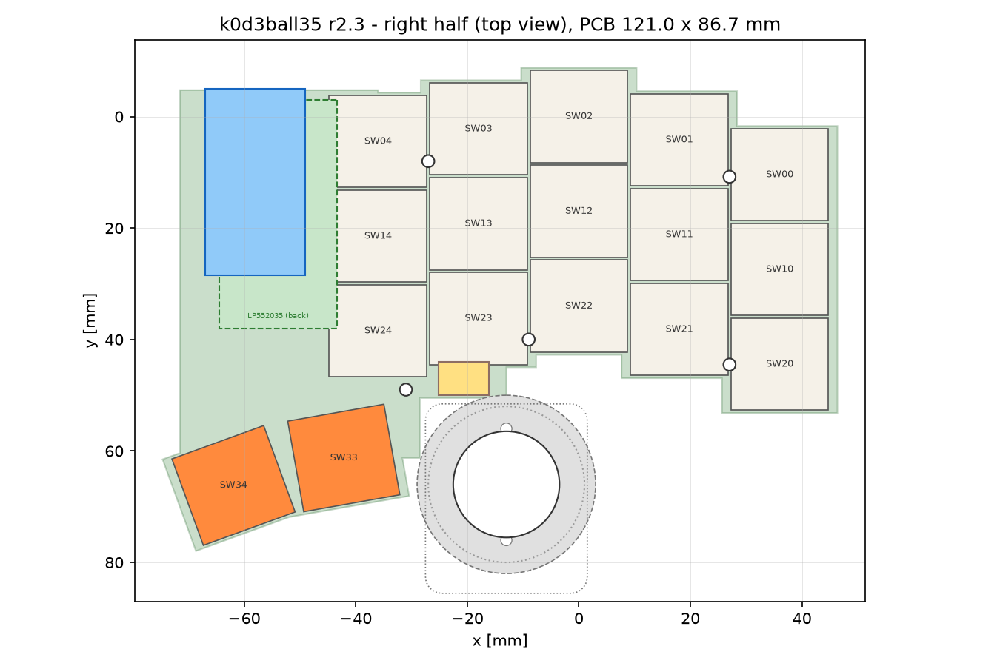
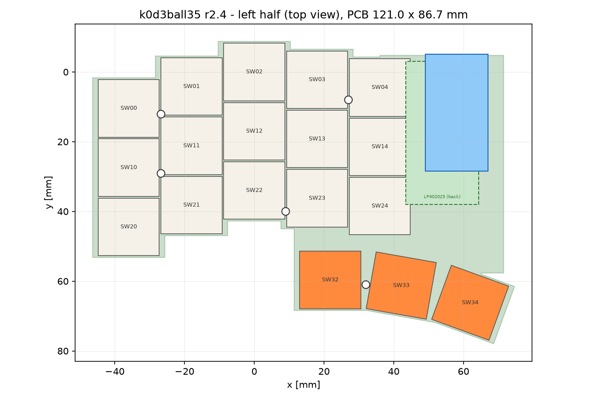

# k0d3ball35

A wireless, low profile, 35-key split keyboard with an integrated 19 mm trackball.
Keyball-inspired column stagger and thumb arc, Kailh Choc V1 hot-swap switches, a nice!nano v2
on each half, ZMK firmware, two flat angular PCBs (18 keys left, 17 keys right) and the ball in a
case pocket right beside the thumb keys.

```prompt
Photorealistic product photo, 35 mm lens, soft window light. Two halves of a low profile split
keyboard on a light oak desk next to a closed silver MacBook. Each half has 15 finger keys in a
column-staggered 3x5 grid with an angular, stepped case outline that follows the stagger; the left
half has three thumb keys fanned in an arc, the right half two thumb keys and, where its third
would be, a matte white 19 mm trackball sitting low in a round pocket of the case. Keycaps are matte
white and light grey low profile caps, the thumb keys are burnt orange. Cases are boxy, warm
beige-grey 3D printed trays about 12 mm tall with a slightly taller rectangular controller box at
the inner edge of each half. No cables anywhere. Shallow depth of field, the right half in focus.
```

## Status

| Subsystem | State | Where |
|-----------|-------|-------|
| Design specification | r2 (two PCBs, 35 keys, 19 mm ball pocket, battery bay under the controller on both halves) | [docs/01-design-spec.md](docs/01-design-spec.md) |
| Layout generator | r2 done, per-half outputs, exact coordinates in [docs/02-layout.md](docs/02-layout.md) | [hardware/layout](hardware/layout) |
| Left PCB (KiCad 10) | r2 routed, ERC and DRC clean, gerbers exported; battery bay on the back silkscreen | [hardware/left-pcb](hardware/left-pcb) |
| Right PCB (KiCad 10) | r2 routed, ERC and DRC clean, gerbers exported; battery bay on the back silkscreen | [hardware/right-pcb](hardware/right-pcb) |
| Sensor PCB (PMW3610) | r1 done, ERC and DRC clean, gerbers exported, unchanged in r2 | [hardware/sensor-pcb](hardware/sensor-pcb) |
| Trackball cradle | r2 pocket mount for 19.05 mm done (25 mm pocket and r1 cutout as variants), test print pending | [hardware/trackball-cradle](hardware/trackball-cradle) |
| Firmware (ZMK) | r2 in progress: 35 keys, one shared pin set | [firmware/zmk-config](firmware/zmk-config) |
| Documentation | build guide, firmware, fabrication, testing written for r2 | [docs](docs) |
| Case | later phase; pocket geometry specified | [issues/mech-case.md](issues/mech-case.md), [issues/mech-case-ball-pocket.md](issues/mech-case-ball-pocket.md) |
| Tests and CI | pytest suite, workflows ready for GitHub | [tests](tests), [.github/workflows](.github/workflows) |

Open work is tracked as markdown tickets in [issues/](issues/README.md). The r2 change itself is
`hw-two-pcbs-r2`. Before the first PCB order, work through `hw-main-pcb-review-r1`,
`test-fab-gerber-viewer`, `hw-19mm-ball-sourcing` and a cradle test print (see
[docs/09-roadmap.md](docs/09-roadmap.md)).











## Features

- 35 keys: 3 rows x 5 columns per half plus 3 thumb keys on the left and 2 on the right (the ball
  takes the third position), 18 x 17 mm pitch
- Column stagger and thumb arc derived from the Keyball39 geometry, scaled to Choc spacing
- Kailh Choc V1 switches in hot-swap sockets (hot-swap only, like the Keyball)
- 19.05 mm (3/4 inch) POM trackball on the right half, resting on three 2 mm ceramic balls in a
  printed cradle that stands in a case pocket beside the PCB; PMW3610 sensor on a small
  daughterboard on the case floor, connected with a 6-pin flat cable; ball top 17 mm above the PCB
- Fully wireless: nice!nano v2 (or SuperMini nRF52840) per half on 2.5 mm low-profile sockets,
  Bluetooth split, one LP552035 LiPo cell (350 mAh) per half in a bay under the PCB below the
  controller (the same bay on both halves), the controller's charger, JST-PH connector, slide
  power switch, reset button
- Two separate PCBs with identical controller wiring: no solder jumpers, no mirrored pin maps,
  no empty ball cutout on the left
- Angular outline: 90 degree steps along the column stagger, rectangular controller block, no rounding
- No LEDs, display or encoder on the PCB, to keep the height and the power draw down
- ZMK firmware on a pinned `main` revision with the upstream PMW3610 driver, automatic mouse layer,
  scroll and snipe modes, ZMK Studio
- All geometry comes from one layout file; schematic, PCB, footprints and tests are generated from the same data

## Repository map

```
docs/                 specification, layout, BOM, build guide, firmware, fabrication, testing
hardware/layout/      layout source (yaml), generated points, outline DXFs and previews per half
hardware/left-pcb/    KiCad project of the left PCB (18 keys), gerbers and renders
hardware/right-pcb/   KiCad project of the right PCB (17 keys, FPC connector, pocket notch)
hardware/sensor-pcb/  KiCad project of the PMW3610 daughterboard
hardware/lib/         project symbol and footprint libraries
hardware/trackball-cradle/  parametric cradle (pocket mount), STL and floor-footprint DXF exports
firmware/zmk-config/  ZMK shield, keymap, build matrix
scripts/              generators and checks (schematic, routing, export, tickets)
tests/                pytest suite incl. KiCad ERC/DRC gates
issues/               markdown tickets and the generated index
```

## Documentation

| Document | Content |
|----------|---------|
| [00 Feasibility](docs/00-feasibility.md) | prior art, ball size research, risks, licensing, why this design |
| [01 Design specification](docs/01-design-spec.md) | requirements, pin map, matrix, FPC interface, geometry contract |
| [02 Layout](docs/02-layout.md) | key coordinates per half, stagger derivation, ball pocket |
| [03 Bill of materials](docs/03-bom.md) | parts, quantities per half, sources |
| [04 Build guide](docs/04-build-guide.md) | step by step assembly |
| [05 Firmware](docs/05-firmware.md) | flashing, pairing, tuning, battery |
| [06 Fabrication](docs/06-fabrication.md) | PCB order settings for both boards, gerber checklist |
| [07 Testing](docs/07-testing.md) | automated checks and bench procedure |
| [08 Trackball module](docs/08-trackball-module.md) | sensor board, lens distance, pocket mount, 19 versus 25 mm |
| [09 Roadmap](docs/09-roadmap.md) | verification before ordering, case, dongle, sensor variants |
| [10 Lessons from Keyball](docs/10-lessons-from-keyball.md) | holykeebs and Yowkees designs, known weaknesses and our response |
| [11 Printed case](docs/11-case.md) | tray, controller box cap, ball pocket, hinged lid as transport cover and tenting foot |
| [12 Order checklist](docs/12-order-checklist.md) | shop-by-shop parts list, what is ordered, JLCPCB and LCSC lines, printed parts, what waits for hardware |
| [Image prompts](docs/images/PROMPTS.md) | every picture as a generation prompt |

## Exploded view

An interactive 3D exploded view of both halves (explode slider, half switch, section through the
ball, layer toggles) lives in [`docs/exploded-view/index.html`](docs/exploded-view/index.html). It
is generated from `points-left.json`, `points-right.json` and the cradle `stack.json` with
`docs/exploded-view/build.py`; the case, the pocket wall and the top frame in it are placeholders
until the case phase.

## Quick start

```sh
brew install --cask kicad          # KiCad 10.0.7 (copy the app from the DMG if the cask asks for admin rights)
brew install openjdk               # Java for freerouting
uv venv .venv && uv pip install --python .venv/bin/python pytest pyyaml shapely ezdxf matplotlib kiutils numpy trimesh
make freerouting-jar               # downloads freerouting 2.5.0 to build/
make test                          # full test suite
```

## Build the hardware files

Everything under `hardware/left-pcb/` and `hardware/right-pcb/` is generated; edit
`hardware/layout/k0d3ball35.yaml` and `scripts/k0d3/` instead of the KiCad files.

```sh
make layout                                   # points-*.json, outline-*.dxf, previews for both halves
JAVA=/opt/homebrew/opt/openjdk/bin/java \
FREEROUTING_JAR=build/freerouting.jar \
make sch pcb route gerbers                    # both halves: schematic + ERC, PCB, freerouting, DRC, export
scripts/build_board.sh right                  # one half: schematic + ERC, unrouted PCB, freerouting, DRC (retries until clean)
scripts/export.sh right                       # one half: gerbers, drill, zip, STEP, renders, schematic PDF, BOM, position file
make erc drc                                  # the KiCad gates on their own
make -C hardware/trackball-cradle             # cradle STLs, floor DXF, previews, stack.json
make case-data case                           # hardware/case: data.scad from the layout, tray/cap/lid STLs, previews, stack.json (needs OpenSCAD)
```

`HALVES=right make route` limits the looping targets to one half. `scripts/build_board.sh` expects
`kicad-cli` and KiCad's bundled Python at
`/Applications/KiCad/KiCad.app/Contents/MacOS/kicad-cli` and
`/Applications/KiCad/KiCad.app/Contents/Frameworks/Python.framework/Versions/Current/bin/python3`;
override with `KICAD_CLI=` and `KPY=`. The sensor board has its own generator:
`hardware/sensor-pcb/generate.py all` followed by `hardware/sensor-pcb/export.sh`.

Firmware is built by GitHub Actions from `firmware/zmk-config`; see
[docs/05-firmware.md](docs/05-firmware.md) for local builds and flashing.

```prompt
Top-down studio render of the right half of a low profile split keyboard, white background, soft
shadows. Bare black PCB with an angular, stepped outline, 17 Kailh Choc hot-swap sockets, small
SOD-123 diodes next to each key, two thumb key positions at the lower inner side and the ball
pocket where a third would be, a nice!nano
controller on low profile sockets in a rectangular block at the inner edge, a dashed rectangle
printed on the board under it marking the battery bay on the other face, an octagonal notch in the lower outer edge of the board where a beige
printed cradle holding a white 19 mm ball stands beside the PCB, a tiny flat flex cable running
from under the cradle to a connector on the PCB. Clean, technical, product photography style.
```

## Credits

- [Keyball](https://github.com/Yowkees/keyball) by Yowkees: the column stagger, thumb arc and the
  idea of a trackball at the thumb are the design inspiration. No Keyball files are used.
- [torabo-tsuki-lp](https://github.com/sekigon-gonnoc/torabo-tsuki-lp) by sekigon-gonnoc: reference
  for a low profile trackball with 25 and 19.05 mm POM balls and a sensor module on a flat cable.
- [LiNEA40](https://github.com/keyfreaks/LiNEA40) by keyfreaks: precedent for a 19 mm ball on a PMW3610.
- [roBa](https://github.com/kumamuk-git/roBa) by kumamuk: reference for a ZMK trackball split with
  PMW3610.
- [kiswitch](https://github.com/kiswitch/kiswitch) and [marbastlib](https://github.com/ebastler/marbastlib):
  switch, socket and controller footprints.
- [ZMK](https://zmk.dev) and the Zephyr PMW3610 driver.

```prompt
Three quarter view close-up of the trackball pocket on the right half: a matte white 19 mm ball
sitting low in a round pocket of a boxy beige 3D printed case, in line with two burnt orange thumb
keycaps to its left, the ball top only a little higher than the keycaps, three tiny ceramic balls just visible
at the rim of the beige cradle, light grey Choc keycaps behind, the angular stepped case edge
visible. Oak desk, soft daylight, macro lens, shallow depth of field.
```

## License

Firmware, scripts and documentation: [MIT](LICENSE).
Hardware (everything under `hardware/`): [CERN-OHL-P-2.0](LICENSE-HARDWARE).
