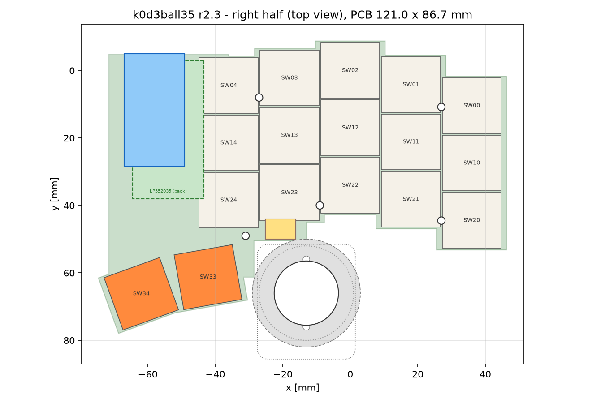
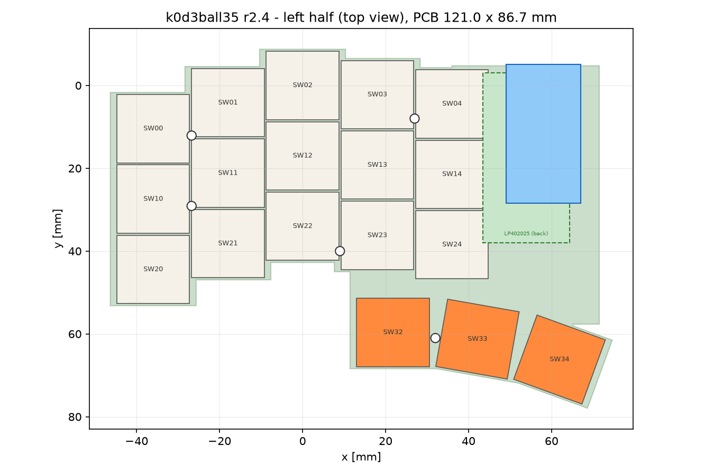

# Key layout

The whole geometry of k0d3ball35 lives in one file, `hardware/layout/k0d3ball35.yaml`. The
generator `scripts/gen_layout.py` turns it into one set of outputs per half in
`hardware/layout/output/`: `points-left.json` and `points-right.json` (consumed by the schematic
and PCB generators, the tests, the exploded view and the firmware physical layout),
`outline-left.dxf` and `outline-right.dxf` (for the case) and the two previews below. Nothing in
the PCBs is placed by hand.






## Coordinate system

Millimetres, one frame per half: x grows outward towards the pinky, y grows downward towards the
user. The origin is the centre of the middle-column top key. This is KiCad's screen orientation,
so the PCB generator adds only a mirror and a page offset. Both halves use the same frame, which
is handedness-neutral: the left BOARD (and its case and lid) is the mirror image of the frame,
x -> -x, so seen from the top the left board has the controller block at its right-hand edge;
the frame, `points-*.json` and `outline-*.dxf` stay unmirrored. The case generator `scripts/gen_case.py` consumes `load_layout()` directly (not the JSON) and mirrors the left half itself; the controller block rectangle it uses is x -71.5 to -45.5, y -4.75 to 50.6 (stopping 1 mm above the SW33 keycap), see `docs/11-case.md`. Since r2 the halves are two different PCBs: everything outside the
`halves:` section of the yaml is shared, the thumb list, the ball pocket, the FPC connector and the
hand routes are per half.

## Derivation from the Keyball39

The Keyball39 is an MX board on a 19.05 mm grid. Its column stagger and thumb arc were measured from
the published gerbers (switch centre coordinates) and scaled to the Choc 18 x 17 mm pitch. Keyball
files are not reused; only these ratios are.

| Column | Keyball39 stagger (mm) | in key units | k0d3ball35 stagger (x 17 / 19.05) |
|--------|------------------------|--------------|------------------------------------|
| pinky | 11.70 | 0.614 | 10.44 |
| ring | 4.70 | 0.247 | 4.19 |
| middle | 0 | 0 | 0 |
| index | 2.50 | 0.131 | 2.23 |
| inner | 5.00 | 0.262 | 4.46 |

Stagger is the y offset of a column's top key relative to the middle column; positive means lower.
Column x positions are simply 0, +-18 and +-36.

Thumb keys are placed relative to the inner column's bottom key. The Keyball39 offsets (+15.05/+23.75,
-6.50/+25.55 and -27.42/+31.07 mm) are scaled by 18 / 19.05 in x and 17 / 19.05 in y; the 0 / 10 / 20
degree rotations are kept. The resulting pitch between neighbouring thumb centres is 20.4 mm, which
leaves a few millimetres between rotated 1u Choc caps. The left half uses all three positions, the
right half the two outer ones (0 and 10 degrees) so that the ball pocket has room beside the thumb.

## Key table, left half (18 keys)

| Ref | Name | Row | Col | x | y | Rotation |
|-----|------|-----|-----|---|---|----------|
| SW00 | pinky_0 | 0 | 0 | 36.00 | 10.44 | 0 |
| SW01 | ring_0 | 0 | 1 | 18.00 | 4.19 | 0 |
| SW02 | middle_0 | 0 | 2 | 0.00 | 0.00 | 0 |
| SW03 | index_0 | 0 | 3 | -18.00 | 2.23 | 0 |
| SW04 | inner_0 | 0 | 4 | -36.00 | 4.46 | 0 |
| SW10 | pinky_1 | 1 | 0 | 36.00 | 27.44 | 0 |
| SW11 | ring_1 | 1 | 1 | 18.00 | 21.19 | 0 |
| SW12 | middle_1 | 1 | 2 | 0.00 | 17.00 | 0 |
| SW13 | index_1 | 1 | 3 | -18.00 | 19.23 | 0 |
| SW14 | inner_1 | 1 | 4 | -36.00 | 21.46 | 0 |
| SW20 | pinky_2 | 2 | 0 | 36.00 | 44.44 | 0 |
| SW21 | ring_2 | 2 | 1 | 18.00 | 38.19 | 0 |
| SW22 | middle_2 | 2 | 2 | 0.00 | 34.00 | 0 |
| SW23 | index_2 | 2 | 3 | -18.00 | 36.23 | 0 |
| SW24 | inner_2 | 2 | 4 | -36.00 | 38.46 | 0 |
| SW32 | thumb_outer | 3 | 2 | -21.78 | 59.65 | 0 |
| SW33 | thumb_middle | 3 | 3 | -42.14 | 61.26 | 10 |
| SW34 | thumb_inner | 3 | 4 | -61.91 | 66.19 | 20 |

## Key table, right half (17 keys)

The fifteen finger keys SW00 to SW24 are at the same coordinates as on the left half. Thumb row:

| Ref | Name | Row | Col | x | y | Rotation |
|-----|------|-----|-----|---|---|----------|
| SW32 | thumb_outer | 3 | 2 | -21.78 | 59.65 | 0 |
| SW33 | thumb_middle | 3 | 3 | -42.14 | 61.26 | 10 |

Rotation follows the KiCad convention (positive is counter-clockwise on screen). Each key's diode
sits 6 mm below the switch centre, rotated with it. The reference designators double as matrix
positions: `SWrc` is row r, column c; column 0 is the pinky, column 4 the inner index column, row 3
the thumb row. Cells (3,0) and (3,1) do not exist; (3,4) exists only on the left.

## Ball pocket (right half)

| Item | Value |
|------|-------|
| Ball centre | (+5.0, +64.0), below the middle/ring columns, outboard of the outer thumb key |
| Ball diameter | 19.05 mm (3/4 inch POM); the cradle also exists for 25 mm, which needs a wider notch |
| Cradle clearance circle | 28 mm diameter (`trackball.cradle_diameter`); the printed cradle is 24.1 mm wide above the PCB plane |
| PCB notch | octagon, apothem 15.0 mm (cradle radius + 1.0 mm `notch_clearance`), with the corner towards the keys and the inner column squared off so the module can be lowered into the pocket past the board edge; vertices in `points-right.json` under `trackball.notch` |
| Case pocket | 32 mm circle (`pocket_diameter`, cradle + 2 mm wall) above the PCB plane; below it a 34 x 34 mm rounded rectangle (3 mm corner radius) around the 29 x 29 mm housing footprint, which has no screw ears: the two M2 x 10 case screws come up through the floor and the sensor board into the cradle's sensor posts, 20 mm apart on the y axis |
| Sensor board | 26 x 25 mm centred under the ball on the case floor, 11.6 mm below the PCB top (`trackball.sensor_board`) |
| Keycap clearance | at least 1.0 mm between the 28 mm circle and any keycap (checked by the generator) |
| Mounting | cradle screwed to the case floor through its sensor posts (two M2 x 10 from below, 20 mm apart); no cradle holes on the PCB |
| Insertion corridor | the housing and the sensor board inside it must not be covered by the board: `Layout.insertion_corridor()` keeps 0.50 mm to the outline all round, which is what makes the module a cartridge (in and out with the PCB fitted) |

The ball centre was moved until the 28 mm circle cleared the outer thumb cap, the ring and the
pinky bottom keys by 1 mm each and the circle stays at least `notch_clearance` away from the rest
of the outline. The generator refuses to write if the cradle circle intersects the PCB outside the
notch. The left half has no pocket: `trackball` is `null` in `points-left.json`.

## Controller block and connectors

| Part | Position | Notes | Halves |
|------|----------|-------|--------|
| Controller U1 | hole-pattern centre (-58, 11.7), USB-C shell 1.5 mm past the top edge | nice!nano v2 / SuperMini, component side up, on 2.5 mm low-profile sockets, nothing underneath | both |
| Battery bay | centre (-53.9, 17.5), 21 x 41 mm, on the back | PKCELL LP552035 cell (350 mAh, 20 x 37 x 5.7 mm) under the PCB in a 9 mm deep well of the case floor, lead end towards +y; dashed outline on the back silkscreen; `battery` block in `points-*.json` | both |
| Power switch PS1 | (-68.5, 30), rotated 270 | MSK12C02, bottom side, actuator through the inner edge (270 puts the footprint's +y actuator at -x) | both |
| Reset button RB1 | (-66, 41) | EVQ-P7A, bottom side, below the battery bay | both |
| JST J3 | (-56, 44) | default battery connection, 6 mm tall, bottom side, below the bay inside the same well | both |
| Battery pads J2 | (-57, 50.5) | 2.54 mm pitch, B+ is the square pad, solder alternative to J3 | both |
| Test pads TP1.. | row from (-66, 57.5), 2.5 mm pitch along x | right: D0, D1, D2, D3, D9; left: the same plus D10, D14, D15, D16 | both |
| FPC J1 | (-2.6, 45.5) | FH12-6S, **key side**, below the middle column's bottom key; the cable climbs beside the cup, folds over the notch edge into the mouth (0.5 mm from the edge) and the lock stays reachable when assembled | right only |

No solder jumpers: RAW, GND, RST and VCC are wired straight to the controller holes.

## Mounting holes

Five M2 holes per half at identical positions. They sit in the 4.2 mm gaps between switch bodies
and outside the bands the hot-swap socket pads occupy:

| Hole | x | y |
|------|---|---|
| H1 | 27.0 | 10.8 |
| H2 | 27.0 | 44.5 |
| H3 | -9.0 | 40.0 |
| H4 | -27.0 | 8.0 |
| H5 | -32.0 | 61.0 |

The case can add standoffs under the controller block; the cradle has its own two screws into the
case floor. Under the controller block the case floor drops to a 9 mm deep well for the battery
(`battery.well_floor_z` in `points-*.json`, -10.6 mm), the same on both halves.

## Outline

The outline is the union of all keycap rectangles (plus 0.5 mm margin and 1.1 mm extra per side for
the socket pads), joined with 90 degree steps that follow the column stagger, the rectangular
controller block at the inner edge (from above the controller down to the thumb cluster) and the
thumb bridge between the index/inner bottom keys and the thumb keys. Corners are not rounded
(`corner_radius: 0`, mitre joins; the fab's 1 mm router radius is accepted). On the right half the
pocket notch is subtracted. The left board outline is the mirror image of this
(controller block at +x, thumb arc leaning the other way). Sizes (bounding boxes): left 121.0 x 86.7 mm, right
117.8 x 80.4 mm; the ball pocket adds about 3 mm of case height beside the right PCB.

## Changing the layout

1. Edit `hardware/layout/k0d3ball35.yaml` (stagger, thumb offsets, per-half thumb lists, ball
   centre, part positions, holes, hand routes).
2. Run `make layout`. The generator prints every key of both halves and refuses to write if keycaps
   overlap, the cradle circle touches a cap or cuts into the outline, a hole collides with a switch
   body or sits too close to the edge, or the battery bay leaves the outline or touches a part on
   the back of the PCB.
3. Look at `hardware/layout/output/preview-left.png` and `preview-right.png`.
4. Run `make sch pcb route drc` (both halves; `HALVES=right` for one) to regenerate and re-route
   the boards, then `make test`.
5. Regenerate the firmware physical layout from `points-left.json` and `points-right.json`
   (`firmware/zmk-config/scripts/gen_physical_layout.py`).

```prompt
Clean technical top-view diagram of the two halves of a 35-key split keyboard on white
background: each half has five columns of three keys in a column-staggered grid (middle column
highest, pinky column lowest) with an angular stepped board outline following the stagger, the
left half with three thumb keys fanning out at 0, 10 and 20 degrees below the inner column, the
right half with only the two outer thumb keys and a 19 mm trackball circle in a notch at
the lower right beside the thumb keys, a Pro Micro sized controller rectangle in a rectangular block
at the inner edge of each half, five small mounting hole circles per half, dimension lines showing
18 mm column pitch and 17 mm row pitch, thin grey lines, labels in a sans-serif font, 16:10.
```
